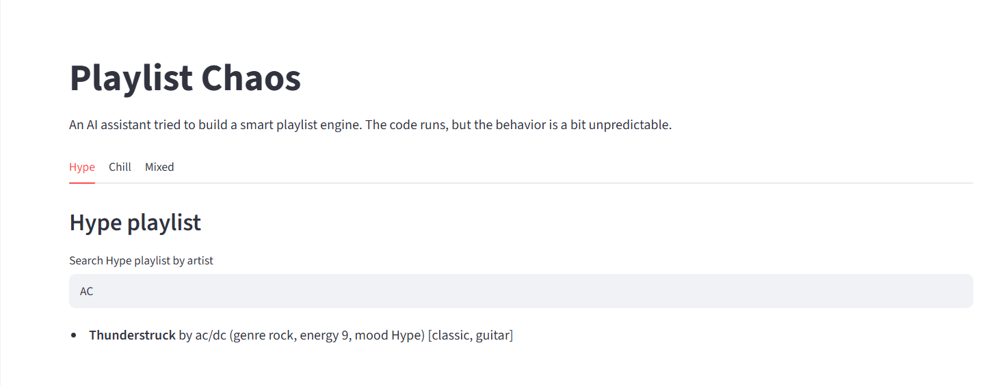
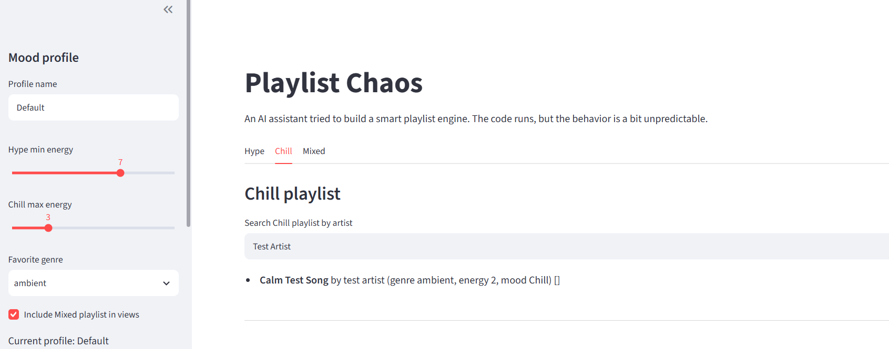

# 🎵 Playlist Chaos: Debugging a Mood-Based Playlist Engine

## Project Overview

Playlist Chaos is a Python and Streamlit application completed as part of CodePath AI Engineering 110, Module 1, Week 1.

The application organizes songs into three mood-based playlists: **Hype**, **Chill**, and **Mixed**, using song information and customizable user preferences.

The starter application contained logic errors that caused unexpected behavior. I used Claude in VS Code as an AI coding assistant to investigate the problems, understand the existing code, implement focused fixes, and verify the results.

## Technologies & Tools

- **Python** — Playlist classification and search logic
- **Streamlit** — Interactive application interface
- **VS Code** — Development environment
- **Claude** — AI-assisted debugging and refactoring
- **Git & GitHub** — Version control and project documentation

## Bugs Identified and Fixed

### Bug 1: Search Did Not Support Partial Matches

**Problem:** Searching for `AC` did not return songs by AC/DC.

**Fix:** Updated `search_songs()` to support case-insensitive, partial-text matching.

**Verification:** Searching for `AC` successfully returned *Thunderstruck* by AC/DC. Searching for `mau` returned *Strobe* by deadmau5.

### Bug 2: Incorrect Mood Classification

**Problem:** A calm song with genre `ambient` and energy `2` could incorrectly appear in the Hype playlist when ambient was selected as the favorite genre.

**Root Cause:** The Hype condition was evaluated before the Chill condition, allowing the favorite genre to override low-energy classification.

**Fix:** Updated `classify_song()` so the Chill condition is evaluated before Hype.

**Verification:** Created a test song with genre `ambient` and energy `2`, selected ambient as the favorite genre, and confirmed that the song appeared in the Chill playlist.

## Code Refactoring

After fixing the classification issue, I used Claude to improve the readability of the classification function without changing its behavior.

The original compound conditions were assigned to descriptive variables:

```python
is_chill = energy <= chill_max_energy or is_chill_keyword
is_hype = genre == favorite_genre or energy >= hype_min_energy or is_hype_keyword

if is_chill:
    return "Chill"
if is_hype:
    return "Hype"
return "Mixed"
```

This made the priority order easier to understand and maintain.

## Testing & Verification

I verified the fixes using the running Streamlit application and direct Python function checks.

| Test Scenario | Expected Result | Outcome |
|---|---|---|
| Search `AC` | Find AC/DC | Passed |
| Search `mau` | Find deadmau5 | Passed |
| Ambient song, energy 2, favorite ambient | Chill | Passed |
| Rock song, energy 9 | Hype | Passed |
| Pop song, energy 8 | Hype | Passed |
| Ambient song, energy 5, favorite ambient | Hype | Passed |
| Pop song, energy 5, favorite rock | Mixed | Passed |

Five classification scenarios were checked directly through Python. The search and low-energy classification fixes were also verified through the Streamlit interface.

## AI Collaboration & Learning

I used Claude to explain the existing code before making changes rather than immediately asking it to rewrite the application.

I reviewed its suggestions, approved focused changes, and tested whether the application behaved according to the assignment requirements.

I learned that the order of conditional statements matters because Python evaluates them sequentially and returns as soon as a matching condition is reached.

I also learned that refactoring should improve code readability without changing its expected behavior.

## Git Version Control

I committed the project improvements in separate stages:

1. `fix: search now matches partial, case-insensitive queries`
2. `fix: corrected playlist behavior`
3. `refactor: improved structure and readability`

This helped separate bug fixes from code readability improvements.

## Running the Application

Install dependencies:

```bash
pip install -r requirements.txt
```

Start the application:

```bash
python -m streamlit run app.py
```

## Reflection

This activity strengthened my understanding of Python conditional logic, deterministic rule-based systems, debugging, verification, and AI-assisted development.

The most important lesson was that AI-generated suggestions should be treated as hypotheses that need to be reviewed and tested rather than automatically accepted.

## Screenshots

### Case-Insensitive Artist Search
Searching "AC" successfully returns "Thunderstruck" by AC/DC.



### Mood Classification
A calm ambient song with energy 2 is correctly classified as Chill, even when ambient is the favorite genre.

